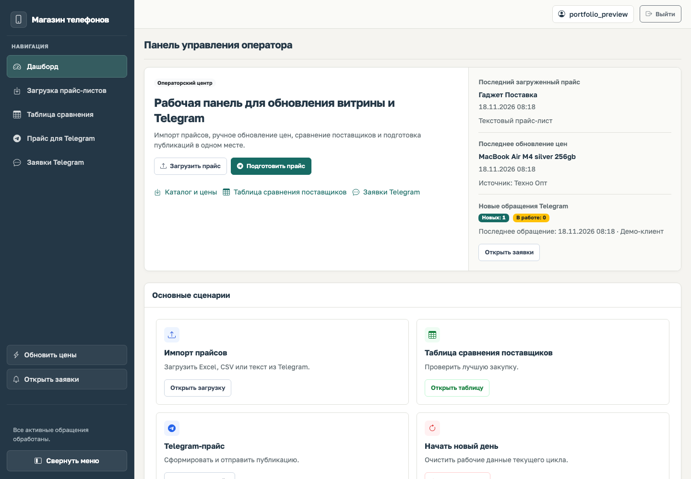
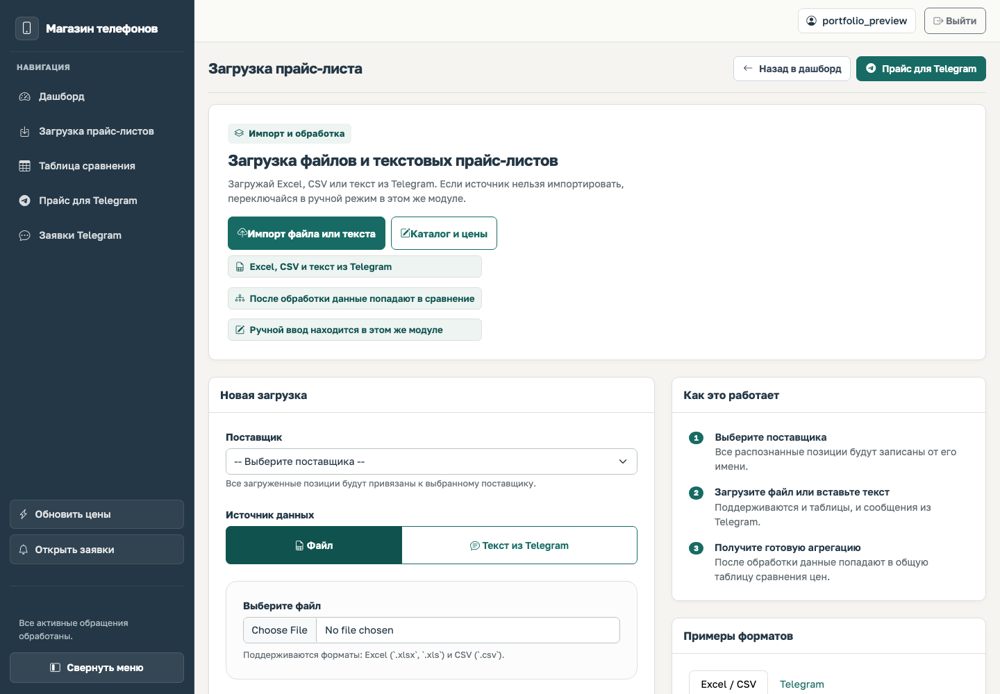
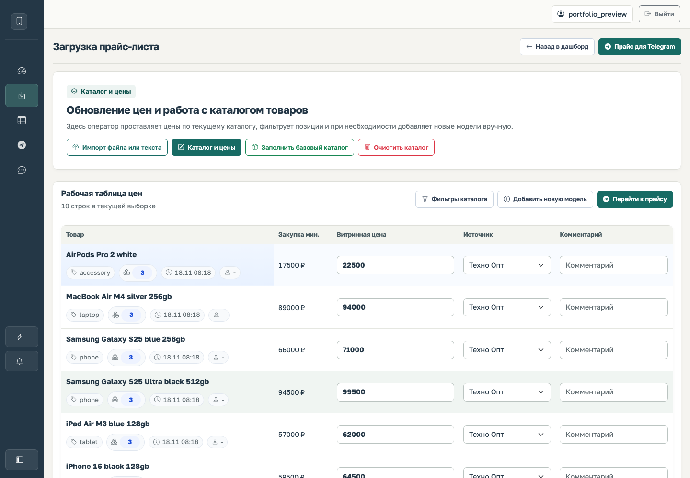
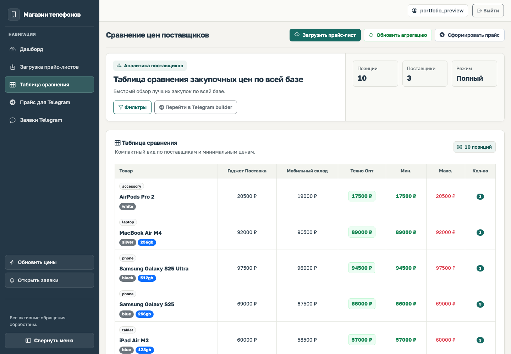
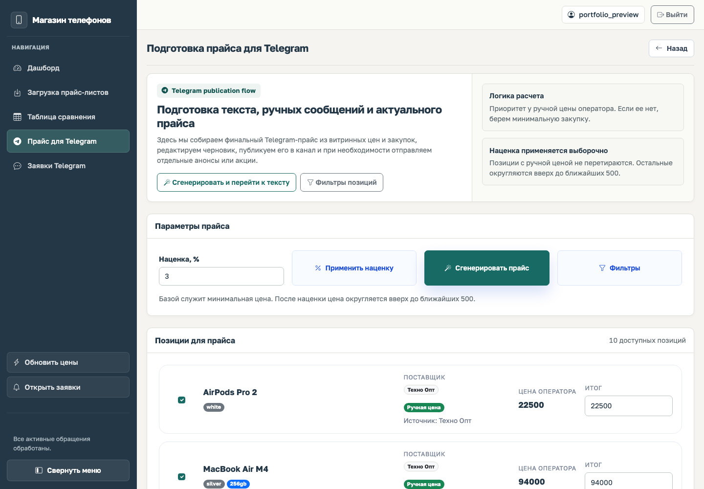
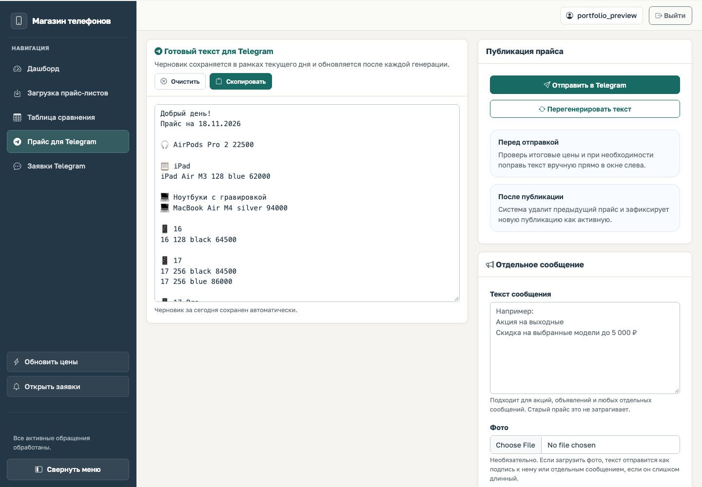
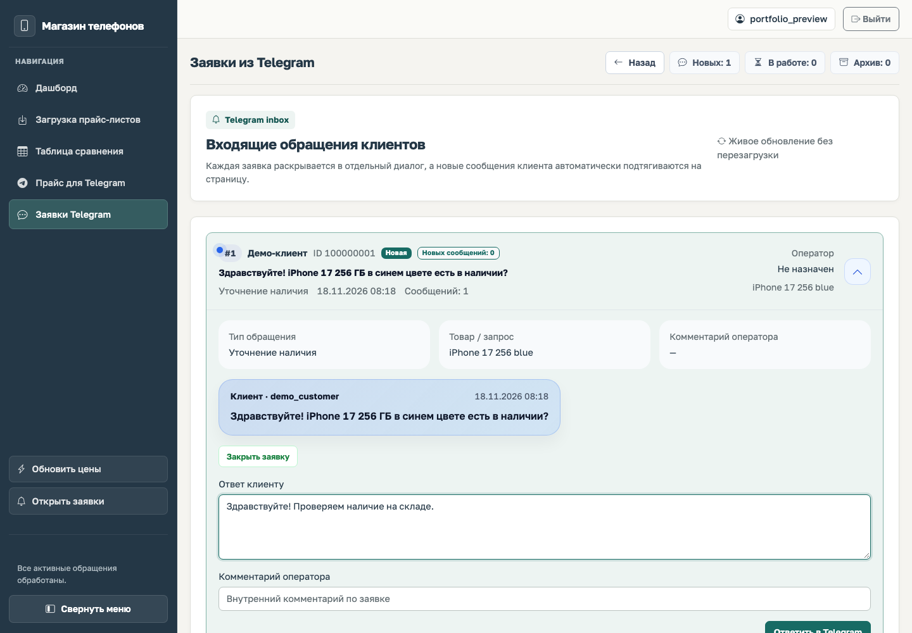
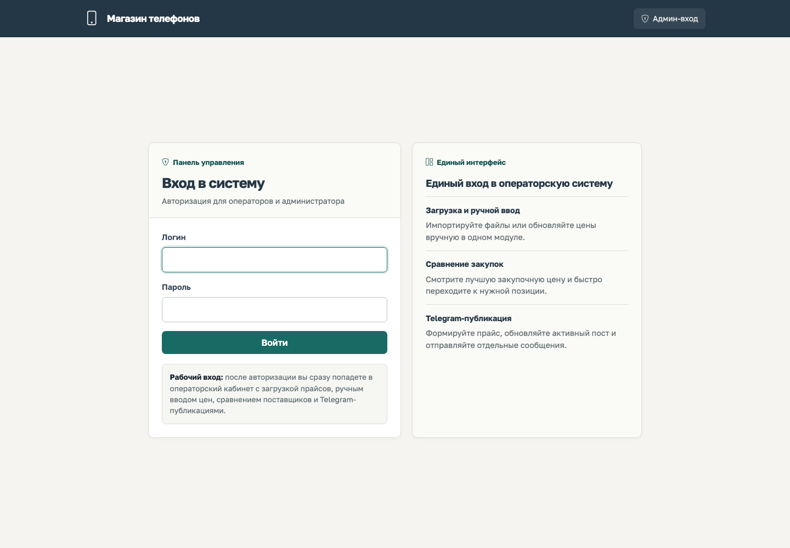
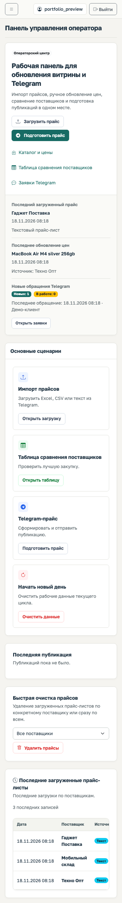

# Phone Shop · Панель оператора

Рабочее место магазина техники: каталог и цены поставщиков, ручные витринные
цены, сравнение предложений и обращения покупателей через Telegram.



## Посмотреть без запуска

Скриншоты работающего приложения сняты на отдельной базе с вымышленными данными.
Ниже показан путь оператора: загрузка предложений, обновление цен, сравнение,
подготовка публикации и ответ покупателю. Изображения можно открыть в полном размере.

### Импорт прайс-листа

Загрузка файла или текста от выбранного поставщика.



### Каталог и ручные цены

Витринные цены, источник предложения и комментарий оператора в одной таблице.



### Сравнение поставщиков

Предложения поставщиков по каждой модели с выделением минимальной цены.



### Подготовка прайса

Выбор позиций и наценки перед генерацией сообщения.



Готовый текст можно проверить и отредактировать перед отправкой в канал.



### Обращения покупателей

Раскрытая заявка с историей переписки и формой ответа через бота.



<details>
<summary>Авторизация и мобильная версия</summary>





</details>

## Статус релиза

Демонстрационная версия для портфолио. [Аудит кода](AUDIT.md) описывает
найденные проблемы, их исправления и ограничения эксплуатации.
В v0.2.1 исправлены атомарность импорта, денежные форматы, замена цен поставщика,
повторы Telegram, частичная отправка прайса и очистка сообщений.

## Модель данных

`Supplier → PriceList → Product` хранит исходные предложения.
`AggregatedProduct → ProductPrice` связывает варианты товара с поставщиками.
`OperatorPrice` задает ручную витринную цену с приоритетом при генерации.
`TelegramCustomerRequest → TelegramCustomerMessage` хранит историю диалога.

Демо-проект панели оператора для магазина техники на Django.

## Что умеет

- загрузка прайс-листов из файла или текста
- ручное обновление каталога и витринных цен
- таблица сравнения поставщиков
- генерация и публикация прайса в Telegram
- Telegram-бот для входящих клиентских обращений
- очередь заявок оператора с живым обновлением

## Стек

- Python
- Django
- PostgreSQL
- Telegram Bot API
- Bootstrap + кастомный CSS

## Локальный запуск

```bash
python -m venv venv
source venv/bin/activate
pip install -r requirements.txt
cp .env.example .env
python manage.py migrate
python manage.py createsuperuser
python manage.py runserver
```

Для просмотра без PostgreSQL задайте `DATABASE_URL=sqlite:///db.sqlite3` до
миграций. Команда `python manage.py seed_demo` добавляет вымышленные модели,
поставщиков и заявку в пустой каталог и не отправляет сообщений.
Общего пароля по умолчанию нет. Для UI-просмотра токен Telegram не требуется.

## Проверка и скриншоты

```bash
python manage.py test operators
python manage.py check
```

Для пересъемки установите `playwright` отдельно от runtime-зависимостей,
выполните `playwright install chromium`, запустите сайт на порту 8011 с отдельной
SQLite-базой и выполните `python scripts/capture_screenshots.py` с тем же
`DATABASE_URL`. Скрипт проверяет страницы, генерацию текста и мобильную ширину.

## Deploy

Проект подготовлен под бесплатный деплой на Render.

Смотрите:

- [DEPLOY_RENDER.md](./DEPLOY_RENDER.md)
- [render.yaml](./render.yaml)

## Важно

- На бесплатном Render файловая система эфемерная.
- Загруженные медиафайлы в таком режиме не являются постоянными.
- Telegram cleanup в демо-режиме работает лениво: при webhook-запросах и заходах в интерфейс.
- После обновления до v0.2.1 выполните `python manage.py migrate`: добавлен учет Telegram-событий и блокировки публикации/каталога.
- Bootstrap и шрифт загружаются с CDN: для полного оформления нужен интернет.
- Для публичного просмотра используйте вымышленные данные и отдельного тестового бота.
